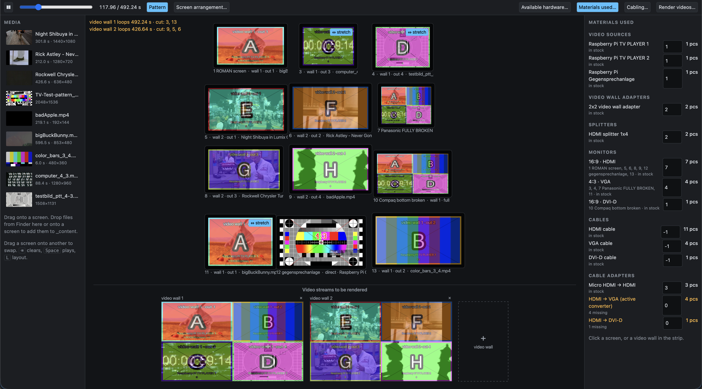

# Video wall

Previz, renderer and cabling planner for monitor walls built from 2x2 video
wall adapters. A video wall is one video source (e.g. a Raspberry Pi) feeding
a 2x2 video wall adapter: the source plays one file, the adapter splits it onto
four monitors, splitters duplicate signals onto more monitors. Monitors can
also hang directly on a source that plays its own file.

> **NOTE**: ⚠ VIBE CODED ⚠



```
python3 wall.py        # opens http://localhost:8770
```

Needs `ffmpeg`, `flask`, `pillow`.

## What it does
- **Previz**: the monitors laid out as on the real wall, with the media dropped on them playing live.
  Outputs without media show a generated stand-in (colour, letter, square and circle to check the aspect).
- **Looping**: each video wall gets one file length, clips loop seamlessly (loop, pingpong, crossfade),
  capped by a max video length per wall.
- **Render**: one file per video wall for its adapter, 4:3 monitors pre-stretched on request; direct
  sources copied or re-encoded; optionally a preview of the whole wall. One format for all or per file.
- **Cabling plan**: per video wall a flowchart and a cable table, with port types, splitters, plug
  adapters and active converters; zoomable viewer and PDF export
  ([example](Video%20wall%20cabling-example.pdf)).
- **Materials**: the available hardware with counts, the materials used with stock, shortages in colour.

## Use
- Drag media onto a monitor, a monitor onto another to swap, `⌫` clears.
- Click a monitor or a video wall in the strip to edit it, `Esc` shows the materials used.
- `Space` plays, `⌘ / Ctrl + Z` / `Y` undo / redo, `L` screen arrangement, `P` patterns.

## Files
path | what
--- | ---
`_content/` | media (drop files on the page to add them), `.proxy/` small previz copies
`wall.json` | the arrangement, saved on every change
`_render/` | `videowall<N>.mp4` per video wall, `<source-name>.*` per direct source, `wall_preview.mp4`; `.png` where all content is still images
